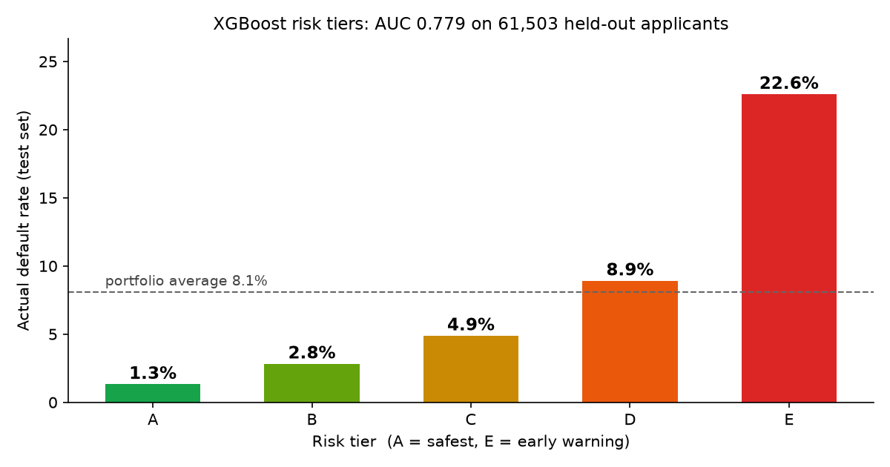
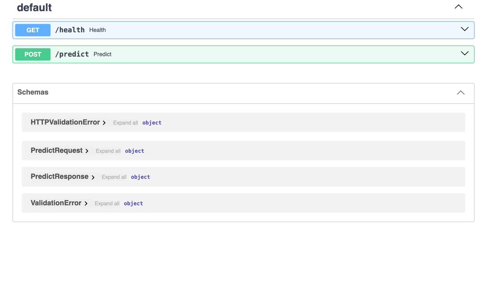

# CreditLens

Loan default prediction pipeline for consumer lending, built on the Home Credit Default Risk dataset
(307,511 applicants, 17.3M source rows). Each stage is a script, and every output can be traced back to the exact source file that produced it.

## Results

| Model | AUC | Gini | KS |
|---|---|---|---|
| Logistic regression (baseline) | 0.756 | 0.512 | 0.383 |
| **XGBoost** | **0.779** | **0.558** | **0.415** |

Held-out test set: 61,503 applicants, never seen during training.

<p align="center"></p>

**Risk tiers** (cut-offs fixed from training-score quintiles):

| Tier | Applicants (test) | Actual default rate |
|---|---|---|
| A | 12,246 | 1.3% |
| B | 12,431 | 2.8% |
| C | 12,305 | 4.9% |
| D | 12,336 | 8.9% |
| **E (early warning)** | 12,185 | **22.6%** |

Tier E defaults about **17× more often** than tier A. That gap is what makes the tiers usable for credit policy, for example manual review or tighter limits for tier E.

**API latency** (500 calls, `api/benchmark.py`): p50 **under 10 ms** (6–10 ms across runs). Without the index on applicant ID, p50 was 39 ms.

**Drift:** 34 of 34 monitored features stable (PSI < 0.10) on a fresh sample. When income is raised 40% and one bureau score lowered 30% in a test batch, the monitor flags exactly those 2 features as DRIFT and leaves the other 32 stable (`tests/test_drift.py`).

**Fair lending:** gender (`CODE_GENDER`) is excluded from the features, because RBI's Fair Practices Code bars discrimination on grounds of sex. Removing it cost 0.001 AUC.

## Pipeline

| Stage | File | What it does |
|---|---|---|
| 1. Load | `pipeline/load.py` | Reads raw CSVs, fixes known data errors (e.g. the `365243` "days employed" placeholder), writes to SQLite, and logs each file's SHA-256 and row counts in a `lineage` table |
| 2. Features | `sql/features.sql` | Builds 44 features per applicant in SQL, using CTEs and window functions, from credit-bureau history, past applications, and instalment repayment behaviour |
| 3. Train | `pipeline/train.py` | Trains logistic regression and XGBoost, reports AUC, Gini, and KS, and assigns risk tiers A–E |
| 4. Serve | `api/main.py` | `POST /predict` returns default probability, risk tier, early-warning flag, and source-file lineage |
| 5. Monitor | `monitoring/drift.py` | Compares a new applicant batch to training with the Population Stability Index and flags features that have shifted |

## API

<p align="center"></p>

`POST /predict {"sk_id_curr": 100002}` returns the following. This applicant did default in the data, and the model flags them as tier E:

```json
{
  "sk_id_curr": 100002,
  "default_probability": 0.3192,
  "risk_tier": "E",
  "early_warning": true,
  "lineage": [
    {"table_name": "application", "source_file": "application_train.csv",
     "source_sha256": "52e96b895b1112e1c853f670e58372719c8441c5ed1c57ac2f7fad559d784f5f"},
    {"table_name": "bureau", "source_file": "bureau.csv",
     "source_sha256": "9d799143423f280720cf51c1bfbbab2a0422da8ff2763335bb30bf43155494f7"}
  ]
}
```

## Run it

```bash
uv venv -p 3.13 .venv && uv pip install -p .venv/bin/python -r requirements.txt
# Put application_train.csv, bureau.csv, previous_application.csv, installments_payments.csv in data/
.venv/bin/python pipeline/load.py
.venv/bin/python pipeline/features.py
.venv/bin/python pipeline/train.py
.venv/bin/python monitoring/drift.py
.venv/bin/python -m pytest tests
cd api && ../.venv/bin/uvicorn main:app   # then POST /predict {"sk_id_curr": 100002}
```

## For a reviewer without a technical background

- **What it predicts:** the chance that an applicant will have trouble repaying.
- **How to check a single decision:** every API answer lists the source files, with their fingerprints (SHA-256), that the score was built from.
- **How to check the model still works:** run the drift monitor. "DRIFT" next to a feature means new applicants look different from the ones the model learned from, and the model should be reviewed.
